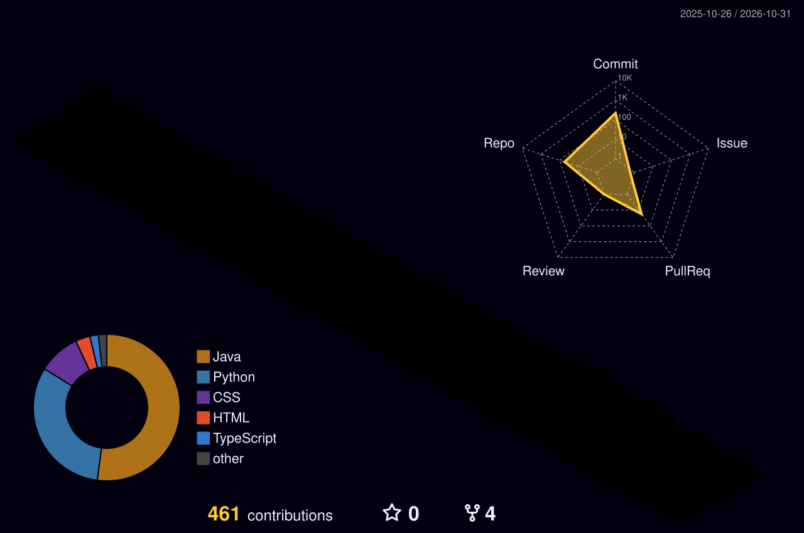

# Krish Kumar

**Backend Developer (Java / Spring Boot)** · Building systems that ship, not just systems that run.

Final-year CSE (AI) student at MIT ADT University, Pune. Backend intern at **.tiesverse**. I debug from logs and source, and I build things beyond tutorials.

<!-- CURRENT-PROJECT:START -->
**Currently working on:** [walletApi](https://github.com/krisjscott/walletApi)

Latest public push: 29 Oct 2026, 12:03 UTC | [3b7423e](https://github.com/krisjscott/walletApi/commit/3b7423ecaba695a7023378ee3766d91d4296546b)

Fix token expiration unit&#44; preserve login password whitespace&#44; and respect injected password encoder
<!-- CURRENT-PROJECT:END -->

---

## What I've Built

### [Digital Wallet API](https://github.com/krisjscott/walletApi) — in progress
> Java 21 · Spring Boot · JPA

Wallet service built to practice real backend concerns: idempotent money movement, optimistic locking with @Version, JWT auth, append-only ledger. HLD/LLD designed first, building milestone by milestone.

### [Credit Decisioning API](https://github.com/krisjscott/credit-decisioning-service-api)
> Java · Spring Boot · JUnit

Rule-based credit decisioning service with a 27-test regression suite.

### [Inventory & Order Management](https://github.com/krisjscott/Inventory-System)
> Java · Spring Boot · React · PostgreSQL · Google OAuth2

Multi-item orders with transactional consistency, pessimistic stock locks and snapshot pricing.

### [LLM Ticket Triage Backend](https://github.com/krisjscott/Ticketing-Based-APP)
> Python · FastAPI · PostgreSQL · GPT-4o-mini

Auto-classifies support tickets, drafts AI replies with human-in-the-loop review, tracks 3-tier SLAs. Built to cut manual triage work.

### [AI Security Scanner](https://github.com/krisjscott/AI-security-scanner)
> Python · Gemini API

CLI combining regex pre-checks with LLM scoring to flag SQL-injection patterns; MD5-based incremental scanning skips unchanged queries.

### [WebServer-Threading](https://github.com/krisjscott/WebServer-Threading)
> Java · JMeter

Single-threaded vs multi-threaded vs thread-pool servers, benchmarked under load with JMeter.

---

## Experience

**.tiesverse** — Backend Intern (April 2026 – Present)
- Fixed N+1 query patterns on core CRUD endpoints, cutting API response times
- Wrote HLD/LLD docs covering service integration and REST API flow
- Stack: Node.js · React · PostgreSQL

---

## Stack

```
Languages     Java · Python · JavaScript · SQL
Backend       Spring Boot · REST APIs · JWT Auth · FastAPI · Node.js (working knowledge)
Data          PostgreSQL · MySQL · JPA / Hibernate
AI / LLM      OpenAI & Gemini APIs · RAG · TensorFlow / Keras · scikit-learn · Hugging Face
Tools         Docker · AWS basics · Git · Linux · JMeter · Swagger
Fundamentals  DSA (250+ problems) · System Design (HLD / LLD) · OOP · SOLID · ACID
```

---

## Research

Co-author — *EEG-based Motor Imagery BCI Classification*, IEEE (2025)

## GitHub Contributions

<div align="center">

</div>

## What I'm Looking For

Remote or Bangalore-based **internship with PPO potential** at a product company or startup.
Backend-heavy roles: APIs, systems, data infrastructure, AI tooling.

## Connect

[LinkedIn](https://www.linkedin.com/in/krishkumar06/) · [GitHub](https://github.com/krisjscott) · krishkumar6566@gmail.com
